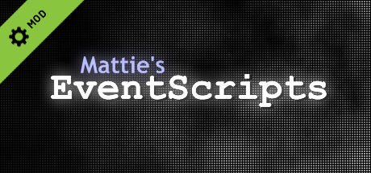

# Mattie's EventScripts

EventScripts is a Source server plugin that connects Source game events and
server commands to Python addons and special cfg-style scripts. See:
https://developer.valvesoftware.com/wiki/EventScripts

Currently, this tree captures the legacy code that aligns pretty near its last
public build: **EventScripts 2.1.1.379** (release package dated April 21, 2013).

## WARNING

Enter at your own risk. This ancient hobby code is a ghastly mess of monolithic
/ organically-grown legacy structures-- all of which needed substantial
refactoring. Most of the worst parts were inherited from the pre-Pythonic era of
EventScripts, but that starting foundation limited the ability to make changes
without risking regressions. Pretty much every coding smell and sin is present
here in one form or another.

## License

EventScripts's own code is reusable under the [MIT License](LICENSE). See
[third-party notices](THIRD_PARTY_NOTICES) for included code and its terms.
